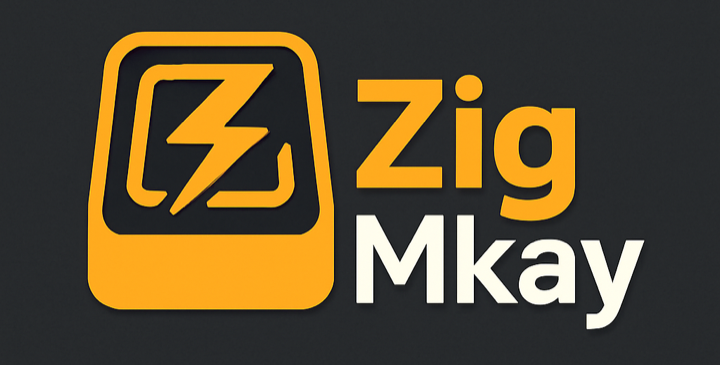
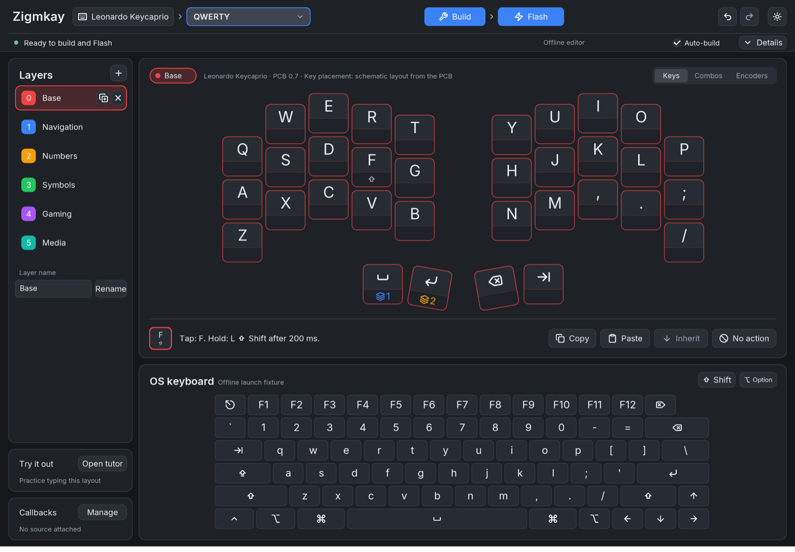
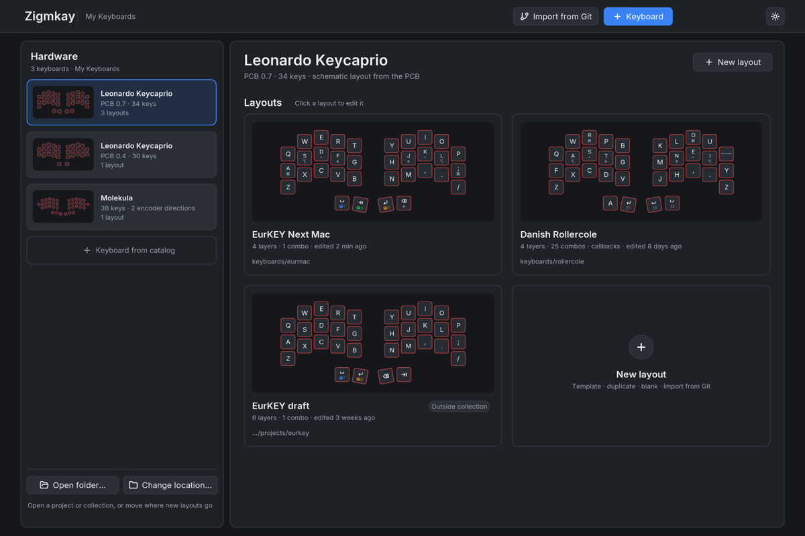
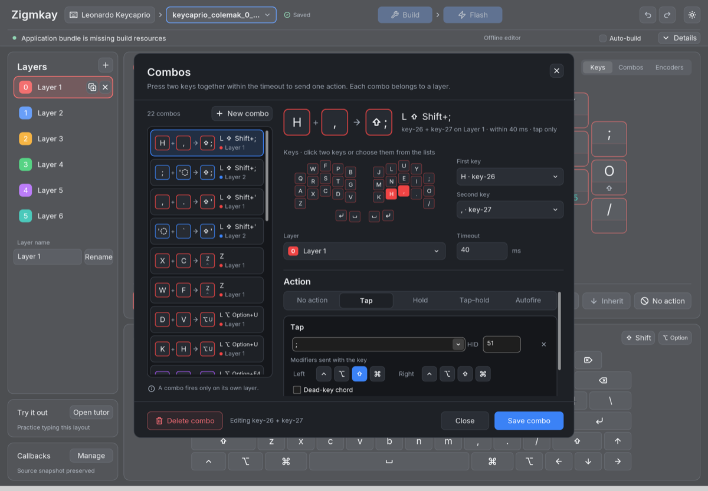
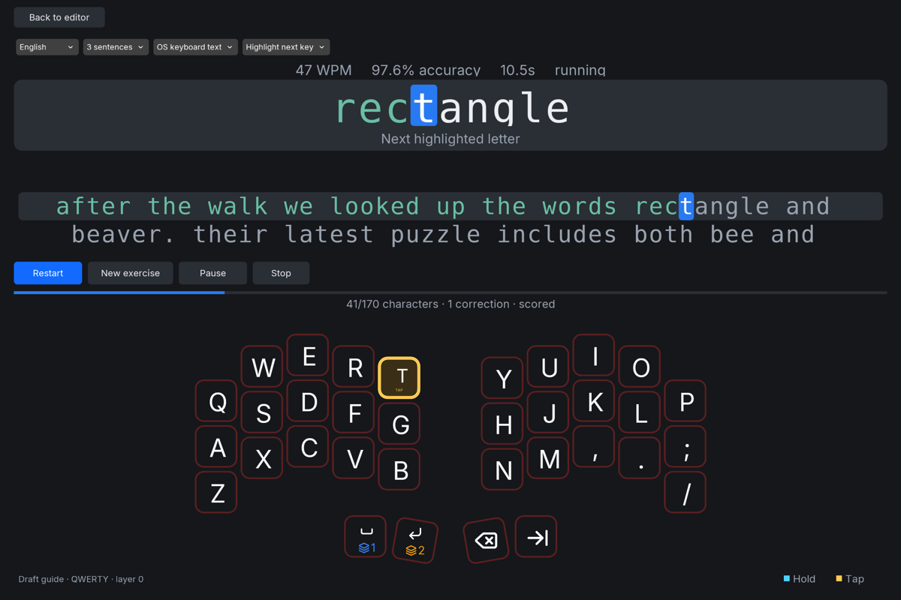
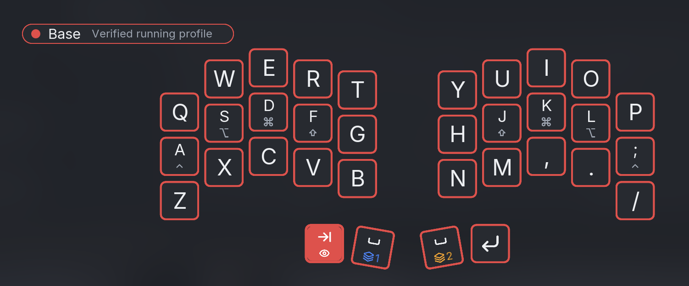

<div align="center">



**Keyboard firmware you can read.<br>A keymap editor you'll actually enjoy.**

[](https://github.com/zigmkay/zigmkay_firmware/actions/workflows/firmware.yml)
[](https://github.com/zigmkay/zigmkay_firmware/actions/workflows/companion-offline-checks.yml)
[](https://github.com/zigmkay/zigmkay_firmware/actions/workflows/companion-application-bundle.yml)
<br>
[](LICENSE)
[](https://ziglang.org/download/)
[](#supported-keyboards)
[](companion/docs/compatibility.md)
[](https://discord.gg/bJCZUtJD65)

[Documentation](docs/README.md) · [Companion](#companion) · [Discord](https://discord.gg/bJCZUtJD65) · [Contributing](CONTRIBUTING.md)

</div>

## What is ZigMkay

ZigMkay is open source firmware for programmable keyboards built on the
Raspberry Pi RP2040. Your keymap is ordinary Zig: layers, tap-hold keys, combos
and custom behaviour are typed values that the compiler checks before anything
reaches the keyboard. The core is plain sequential code (scan, process, send)
with no hidden events or interrupts, and the processing step is covered by an
extensive test suite.

ZigMkay is for people who build or tune their own split and compact keyboards
and want firmware they can read end to end. If you would rather click than
type, the bundled **ZigMkay Companion** edits the same keymaps visually, builds
and flashes the firmware, shows your live layer on screen and lets you practise
the layout in a typing tutor.

## Contents

- [Features](#features)
- [Quick start](#quick-start)
- [Supported keyboards](#supported-keyboards)
- [Companion](#companion)
- [Writing a keymap](#writing-a-keymap)
- [Documentation](#documentation)
- [Contributing](#contributing)
- [Community](#community)
- [AI usage](#ai-usage)
- [License](#license)

## Features

| | |
| --- | --- |
| **Keymaps in Zig.** Layers are arrays of `KeyDef` values; mistakes are compile errors, not surprises on the desk. | **Tap, hold, tap-hold.** Per-key tapping terms, permissive hold always on, optional retro tapping. |
| **Hold layers and modifiers together.** One hold can switch a layer *and* add modifiers. | **Taps with their own modifiers.** Fire `AltGr+7` on tap and still hold a modifier on the same key; dead keys too. |
| **Autofire.** Per-key repeat with its own start delay and interval, for arrows and Vim motions. | **Two-key combos.** A combo fires anything a key can, including holds and layer switches, per layer. |
| **One-shot modifiers and layers.** A tap arms a hold for the next key. | **Media and mouse.** Consumer control (volume, tracks, mute) and mouse buttons and wheel. |
| **Rotary encoders.** Quadrature encoders fire a tap per step: keys, media, mouse wheel. | **Split keyboards.** Primary and secondary halves over UART or PIO UART; unibody boards too. |
| **Custom code where you need it.** One `on_event` callback sees tap and hold enter/exit and every tick. | **Raw HID companion link.** Silent until a host connects; then streams layers, modifiers and key events. |
| **Flashing built in.** `picotool` is built from source, or copy to the mounted `RPI-RP2` drive. | **Locale keycodes.** `zkeycodes` generates Zig keycodes from QMK's locale layouts, around 70 of them. |

ZigMkay deliberately leaves out wireless, RGB and tap dance. See
[Design principles](docs/development/architecture.md#design-principles).

## Quick start

1. **Install the tools.** Install [mise](https://mise.jdx.dev/installing-mise.html)
   and Git. mise selects exactly Zig 0.17.0 for this repository.

2. **Clone and set up.**

   ```sh
   git clone https://github.com/zigmkay/zigmkay_firmware.git
   cd zigmkay_firmware
   mise trust --all && mise install
   mise exec -- zig version        # prints 0.17.0
   ```

3. **Build your keyboard.** Pick a name from the [table below](#supported-keyboards):

   ```sh
   mise run //keyboards:build lk8  # writes keyboards/zig-out/firmware/zigmkay_firmware.uf2
   ```

4. **Flash it.** Start the command, then put the keyboard into bootloader mode
   (hold BOOT while plugging it in, or hold BOOT and press RESET). The command
   waits for the keyboard, flashes it and exits.

   ```sh
   mise run //keyboards:flash lk8
   ```

5. **Or do it all visually.** Start the companion, choose your keyboard and a
   layout, and press **Build** and **Flash**:

   ```sh
   mise run //companion:editor
   ```

On Linux, picotool needs a udev rule once (`mise run //keyboards:udev`). Mount
paths, picotool and other options are covered in
[Building and flashing](docs/development/getting-started.md#flashing). To keep
a keymap of your own, run `mise run //keyboards:keymap:new lk8`; the
[keyboards README](keyboards/README.md) shows every task.

## Supported keyboards

Every board below is an RP2040 build target from
[`keyboards/boards.zig`](keyboards/boards.zig). Pass its name to
`mise run //keyboards:build <name>` or `mise run //keyboards:flash <name>`.

| Keyboard | Build targets | Controller | Layout | Notes |
| --- | --- | --- | --- | --- |
| Leonardo Keycaprio | `lk1`, `lk2` | RP2040 | Unibody, 30 keys | PCB 0.1 and 0.2 |
| Leonardo Keycaprio | `keycaprio_colemak_0_4` | RP2040 | Unibody, 30 keys | PCB 0.4, Colemak keymap |
| Leonardo Keycaprio | `lk6`, `lk7`, `lk8` | RP2040 | Unibody, 34 keys | PCB 0.6 to 0.8 |
| Leonardo Keycaprio | `keycaprio_colemak_0_6`, `keycaprio_colemak_0_7`, `keycaprio_us_intl_0_7` | RP2040 | Unibody, 34 keys | Colemak and US International keymaps |
| Clacky Chan | `clacky_chan`, `clackychan_colemak` | RP2040 per half | Split (UART), 30 keys | Default and Colemak keymaps |
| Dasbob | `dasbob` | RP2040 per half | Split (UART / PIO UART), 36 keys | Direct wiring; the starter example in [`keyboards/examples/dasbob/`](keyboards/examples/dasbob/) |
| Tucky Two Times | `tuckytwotimes` | RP2040 per half | Split (UART), 30 keys | Two rotary encoders |
| Molekula | `molekula` | RP2040 | Unibody, 38 keys | One rotary encoder (volume) |
| Encoder demo | `encoder_demo` | RP2040 | 1 key + encoder | Minimal encoder example; not offered in the companion |

The companion offers every board that has a separate keymap file, with a
schematic of its PCB. Your board is not listed?
`mise run //keyboards:board:new <name>` creates one; see
[Add a new keyboard](keyboards/README.md#add-a-new-keyboard).

## Companion

<p align="center">
  
</p>

The [ZigMkay Companion](companion/README.md) is a native desktop application
for the same firmware, written in Zig and living in [`companion/`](companion/).

- **Visual keymap editor.** Click the upper half of a key for its tap, the lower
  half for its hold. Layers, combos, encoders, one-shots, media and mouse keys,
  with undo and redo.
- **Build and Flash.** Compile the firmware and flash it from the toolbar;
  Auto-build compiles while you edit. The installed application carries its own
  Zig toolchain and firmware sources.
- **Live companion overlay.** A transparent, click-through overlay that follows
  the active layer, modifiers and pressed keys of a connected keyboard. Bind a
  key to **Show / hide companion** to bring it up.
- **Typing tutor.** Check a freshly flashed layout key by key, then run short
  English tests or Zig lessons with words per minute and accuracy.

<table>
  <tr>
    <td width="50%"></td>
    <td width="50%"></td>
  </tr>
  <tr>
    <td align="center"><sub>Your keyboards and layouts</sub></td>
    <td align="center"><sub>Combos on the PCB schematic</sub></td>
  </tr>
  <tr>
    <td width="50%"></td>
    <td width="50%">
      
    </td>
  </tr>
  <tr>
    <td align="center"><sub>Typing tutor</sub></td>
    <td align="center"><sub>Live layer overlay</sub></td>
  </tr>
</table>

Start it from the repository root:

```sh
mise run //companion:editor      # the editor, connects to your keyboard automatically
mise run //companion:companion   # start hidden, with the tray icon and overlay only
```

Read the [companion README](companion/README.md) for the full tour,
[typing practice](companion/docs/typing-practice.md),
[preview releases](companion/docs/preview-releases.md) and
[platform status](companion/docs/compatibility.md).

## Writing a keymap

A keymap is a Zig file with one array per layer. Each entry is a `KeyDef`:
`tap_only`, `hold_only`, `tap_hold`, `tap_with_autofire`, `.none` for a key
that does nothing, or `null` to inherit from the layer below. This excerpt
from [`keyboards/examples/dasbob/keymap.zig`](keyboards/examples/dasbob/keymap.zig)
shows the base layer and a tap-hold key that types Enter on tap and holds
Shift:

```zig
const keycodes = @import("zkeycodes");
const dk = keycodes.layouts.danish;
const us = keycodes.layouts.keycodes.kcf;

pub const key_count = 36;

pub const keymap = [_][key_count]?zigmkay.core.KeyDef{
    // BASE_LAYER: 0
    .{
         T(dk.Q), T(dk.W), T(dk.E), T(dk.R),     T(dk.T),                  T(dk.Y), T(dk.U),      T(dk.I),    T(dk.O),   T(dk.P),
         T(dk.A), T(dk.S), T(dk.D), T(dk.F),     T(dk.G),                  T(dk.H), T(dk.J),      T(dk.K),    T(dk.L),   T(dk.SCLN),
         T(dk.Z), T(dk.X), T(dk.C), T(dk.V),     T(dk.B),                  T(dk.N), T(dk.M),      T(dk.COMM), T(dk.DOT), T(dk.SLSH),
                           T(dk.A), Enter_Shift, T(dk.B),                  T(dk.T), Space_Arrows, T(dk.C)
    },
    // ...
};

pub const tapping_term = core.TimeSpan{ .ms = 250 };
pub const Enter_Shift = core.KeyDef{
    .tap_hold = .{
        .tap = .{ .key_press = us.ENTER },
        .hold = .{ .hold_modifiers = .{ .left_shift = true } },
        .tapping_term = tapping_term,
    },
};
```

The board's main file wires pins and passes the keymap to the processor; it
reaches the keymap as `@import("keymap")`, so one board can be built with
several keymaps. The [keymap guide](docs/keymaps.md) covers every key type,
combos, encoders and custom code.

## Documentation

| | |
| --- | --- |
| [Documentation index](docs/README.md) | Start here |
| [Keymap guide](docs/keymaps.md) | Key types, combos, encoders, custom code |
| [Getting started for developers](docs/development/getting-started.md) | Tools, building, testing, flashing |
| [Repository layout](docs/development/repository-layout.md) | The packages and how they fit together |
| [Adding a keyboard](docs/development/adding-a-keyboard.md) | Board table, keymap, companion descriptor |
| [Architecture](docs/development/architecture.md) | Scan, process, send; split and encoders |
| [Companion protocol](docs/development/companion-protocol.md) | The Raw HID messages |
| [Testing and CI](docs/development/testing-and-ci.md) | Test tasks and GitHub workflows |
| [Companion development](companion/docs/development.md) | Building and testing the desktop application |

## Contributing

Contributions are welcome: new boards, firmware features, companion
improvements, documentation and bug reports. Read [CONTRIBUTING.md](CONTRIBUTING.md),
then the [developer guide](docs/development/getting-started.md). Run
`mise run test` before you open a pull request.

## Community

Questions, build logs and keymap ideas are welcome on the ZigMkay Discord.

<p>
  <a href="https://discord.gg/bJCZUtJD65"></a>
</p>

Bugs and feature requests also go to
[GitHub issues](https://github.com/zigmkay/zigmkay_firmware/issues).

## AI usage

Parts of this firmware were developed with AI assistance. All AI-generated
code, features and changes were reviewed and tested by human developers before
inclusion. See [AI_USAGE.md](AI_USAGE.md).

## License

ZigMkay is free software, licensed under the GNU General Public License,
version 2 or (at your option) any later version (`GPL-2.0-or-later`). See
[LICENSE](LICENSE) for the version 2 text. Imported companion dependencies keep
their own notices; see [companion/NOTICE](companion/NOTICE).
