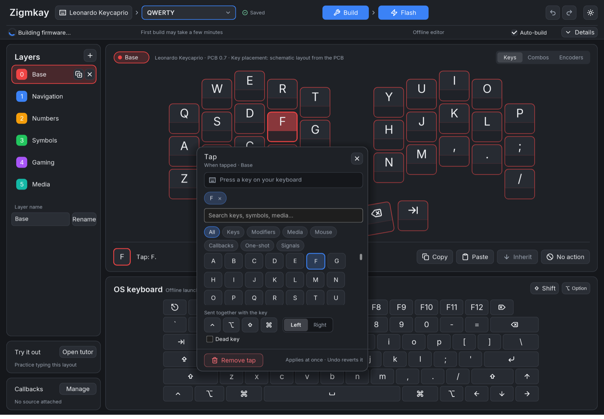
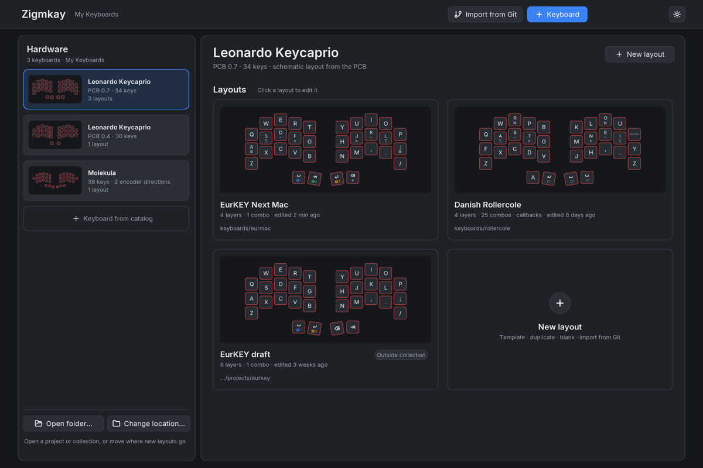
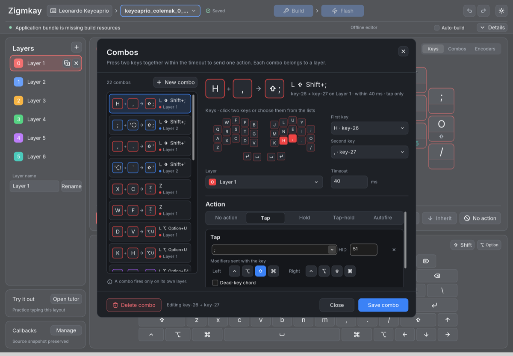
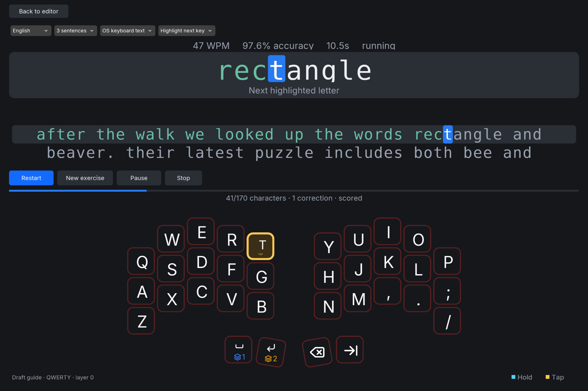
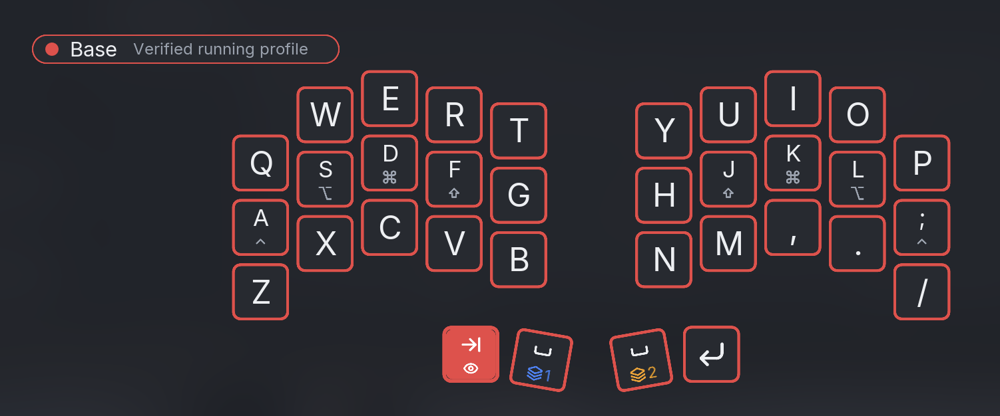

<div align="center">

# ZigMkay Companion

**Make your keyboard yours. Learn it as you go.**

A native visual keymap editor, a live keyboard overlay and a typing tutor for
keyboards running [ZigMkay firmware](../README.md). Written in Zig.

[Features](#features) · [Install and run](#install-and-run) · [Preview releases](#preview-releases-and-platform-status) · [Development](#development) · [Discord](https://discord.gg/bJCZUtJD65)

</div>

<p align="center">
  
</p>

The companion is the `companion/` package of the ZigMkay firmware repository.
It builds on the firmware in the same checkout, so the editor always compiles
the processor, keycodes and board sources it sits next to. One resident desktop
application holds the editor, the overlay and the tutor, reachable from a
keyboard icon in the tray.

## Features

- **Visual keymap editor.** Every key has two halves: click the upper half to
  choose what it types, the lower half to choose what it does while held. Press
  the key on your computer's keyboard, search for an action, or drag a key from
  the OS keyboard palette onto either half. Changes apply at once, with undo
  and redo.
- **Tap, hold and autofire without modes.** The key type follows from what you
  set. Tune tapping terms and autofire delays, combine keys with left or right
  modifiers, use layer holds and one-shots, and tell inherited keys apart from
  keys that do nothing. Media controls, mouse actions and companion signals are
  assignable too.
- **Combos.** Pick the two keys of a combo on the PCB schematic and give the
  combo its own action.
- **Encoders as knob directions.** On boards with rotary encoders, the
  **Encoders** tab shows each knob with one action per direction, clockwise and
  counter-clockwise. A knob's push button is an ordinary key on the keyboard.
- **Your keyboards and layouts.** **My Keyboards** groups layouts by keyboard
  and PCB revision. Start a layout from a firmware default, a copy, a blank base
  layer or an [import from Git](docs/keyboard-projects.md); callback source is
  preserved and refreshed only when you ask.
- **Build and Flash.** **Build**, **Flash** and optional **Auto-build** sit in
  the toolbar. **Flash** builds the project if needed, requests BOOTSEL,
  transfers the verified UF2 and waits for the keyboard to reconnect; if BOOTSEL
  is not found, the editor asks you to enter it by hand. Auto-build compiles
  while you edit and never starts a transfer. The installed application carries
  its own Zig compiler, firmware sources and flash tools, so it builds offline.
  The first build compiles the build tools once, about a minute on a recent
  Mac; the editor starts it in the background shortly after launch and shows
  it as **Preparing build caches**. A Build or Flash click in that time is
  queued and runs when it ends. Later builds take seconds, and the caches stay
  bounded ([details](docs/development.md#compiler-cache-warm-up-and-cleanup)).
  The buttons show where the work stands: the next step glows, a working step
  shimmers, and **Details** below the toolbar holds this session's build and
  flash timeline and the compiler output of the last build.
- **Live overlay.** A transparent, click-through overlay of your keyboard that
  follows the running layout's active layer, modifiers and pressed keys over a
  verified connection. Bind a key's tap or hold to **Show / hide companion**
  (reserved signal `255`) or use `KC_COMPANION`: each tap toggles the overlay
  and it stays that way, while a hold shows it only for as long as the key is
  held. One tap/hold key can do both. Keyboards flashed before the signal
  carried its source fall back to timing: a press shorter than 250 ms toggles,
  a longer one shows the overlay while held. Losing the connection hides it;
  editor changes stay a draft until built and flashed.
- **Tray.** Close the editor and the application stays resident. The tray menu
  shows the device status and opens the editor, shows or hides the companion,
  binds the saved editor project to the live companion and quits Zigmkay.
- **Typing tutor & Test keys.** Choose **Open tutor** in the editor for an
  adaptive 6-stage typing tutor (real English words from the most word-forming
  letters on, all letters with focus-key unlocks, opposite-hand Shift,
  punctuation/numbers, layers & 2-key combos, and free text / Zig code) that
  flows from lesson to lesson and forgives typos, with local per-profile
  progress, or switch to **Test keys**
  to verify switches, layers, holds, and combos unscored; see the
  [typing practice guide](docs/typing-practice.md).

<table>
  <tr>
    <td width="50%"></td>
    <td width="50%"></td>
  </tr>
  <tr>
    <td align="center"><sub>Your keyboards and layouts</sub></td>
    <td align="center"><sub>Combos on the PCB schematic</sub></td>
  </tr>
  <tr>
    <td width="50%"></td>
    <td width="50%"></td>
  </tr>
  <tr>
    <td align="center"><sub>Typing tutor</sub></td>
    <td align="center"><sub>Live layer overlay</sub></td>
  </tr>
</table>

## Install and run

Install [mise](https://mise.jdx.dev/installing-mise.html) and Git, then run
the companion from source, from the repository root:

```sh
git clone https://github.com/zigmkay/zigmkay_firmware.git
cd zigmkay_firmware
mise trust --all && mise install
mise exec -- zig version         # prints 0.17.0
mise run //companion:editor      # the editor; connects to your keyboard automatically
```

mise selects exactly Zig 0.17.0. The first build downloads pinned dependencies
and assembles the complete application. On macOS, compiling from source needs
the Xcode Command Line Tools (`xcode-select --install`).

To start only the resident companion, with its windows hidden and the tray
icon showing:

```sh
mise run //companion:companion
```

Normal startup monitors compatible keyboards automatically. Firmware is
transferred only when you choose **Flash**. For a session without keyboard
monitoring, pass `--offline` through mise and `zig build`:

```sh
mise run //companion:editor -- -- --offline
```

Closing the editor can leave the tray resident running; choose **Quit Zigmkay**
to exit.

## Preview releases and platform status

Preview packages are unsigned and include Zig 0.17.0, the firmware sources and
the flash tools, so they need no checkout and no Zig install: a DMG for macOS
(Apple Silicon and Intel), a portable EXE for Windows and an AppImage for
Linux. The [application workflow](../.github/workflows/companion-application-bundle.yml)
builds them for pull requests and `main`, and publishes a prerelease for a
`companion-vMAJOR.MINOR.PATCH-preview.N` tag that matches the version in
[`build.zig.zon`](build.zig.zon). The offline, desktop and typing practice
checks run from the other `.github/workflows/companion-*.yml` workflows.

- [Preview releases](docs/preview-releases.md): packaging, Linux device
  permissions, CI and publishing.
- [Compatibility status](docs/compatibility.md): what source checks prove and
  which platform and hardware acceptance gates remain.

## Development

All tasks run from the repository root; the root `mise.toml` is a mise
monorepo and `//companion:<task>` names a task from [`mise.toml`](mise.toml).

| Command | Purpose |
| --- | --- |
| `mise run //companion:check` | Compile every source, tool and test without devices |
| `mise run //companion:test` | Run all offline tests |
| `mise run //companion:firmware:check` | Compile every board with synthetic, default and imported keymaps; never flashes |
| `mise run //companion:desktop:check` | Compile the native editor and GUI dependencies without launching |
| `mise run //companion:editor:build` | Assemble the complete application without launching |
| `mise run //companion:editor:test` | Run offline GUI fixtures |
| `mise run //companion:typing-practice:test` | Check typing test generation, scoring and tutor controls |

`mise run test` at the repository root runs the firmware tests as well.
Builds, tests and offline startup never access keyboards.

The [development guide](docs/development.md) covers the source map, every
`zig build` step and option, application assembly and CI. Firmware internals,
the Raw HID protocol and adding a keyboard are documented in the
[repository docs](../docs/README.md).

## Community

Questions, bug reports and layout ideas are welcome on the
[ZigMkay Discord](https://discord.gg/bJCZUtJD65) and in
[GitHub issues](https://github.com/zigmkay/zigmkay_firmware/issues).

## AI usage

Parts of the companion were developed with AI assistance. All AI-generated
code, features and changes were reviewed and tested by human developers before
inclusion. See [AI_USAGE.md](../AI_USAGE.md).

## License

ZigMkay Companion is free software: you can redistribute it and/or modify it
under the terms of the GNU General Public License as published by the Free
Software Foundation, either version 2 of the License, or (at your option) any
later version (`GPL-2.0-or-later`). See [LICENSE](LICENSE) for the version 2
text. The firmware it compiles is licensed under the same terms. Imported
dependencies keep their own license notices; see [NOTICE](NOTICE).

The Tutor's word list, [src/desktop/tutor_words_en.txt](src/desktop/tutor_words_en.txt),
is licensed CC BY-SA 4.0, which is compatible with GPL version 3 only. The
application, which embeds the list, is therefore distributed under GPL version 3
or (at your option) any later version (`GPL-3.0-or-later`); see
[licenses/GPL-3.0.txt](licenses/GPL-3.0.txt). The sources keep their
`GPL-2.0-or-later` grant, and the firmware does not contain the list.
