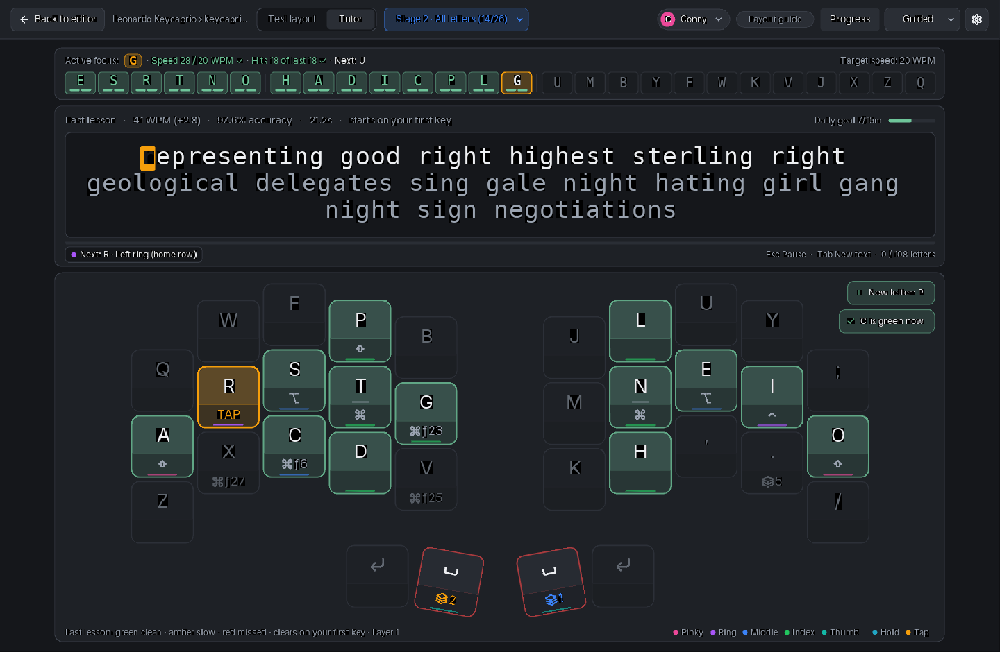
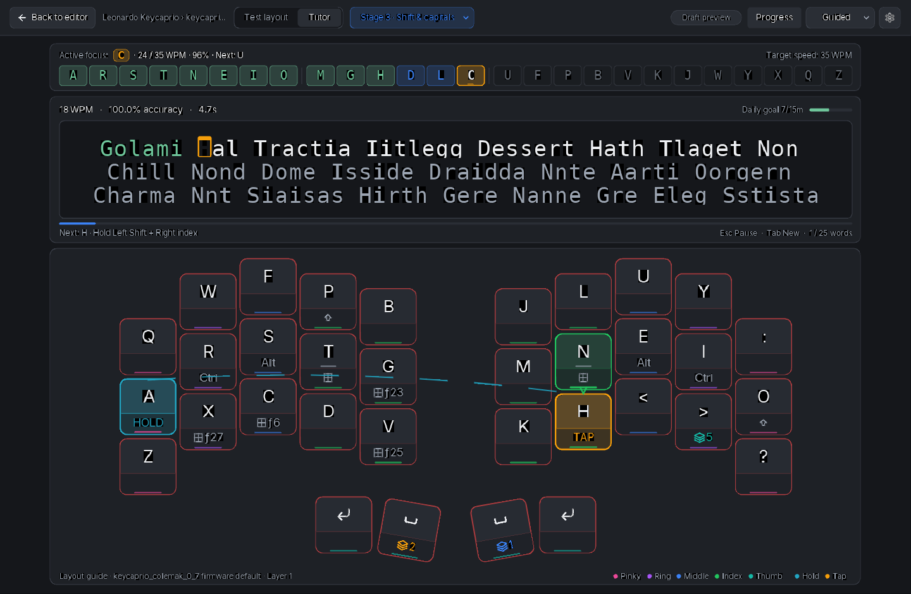

# Test Layout & Adaptive Typing Tutor

Choose **Open tutor** under **Try it out** in the Companion Editor to test your
layout freely or switch to the adaptive 6-stage Typing Tutor.

The top bar provides a **Test layout | Tutor** segmented switch. Opening from
**Try it out** always lands in **Test layout** first so you can immediately
verify switches, layers, holds, combos, and free-type in the scratchpad before
switching to **Tutor**.

## Adaptive Typing Tutor

Opening **Tutor** starts a ready lesson immediately—no setup modal required.
Lessons follow each other without a stop: when you type the last letter of a
lesson, it is counted and the next one is already there. Lessons in Stages 1
and 2 are about 100 letters of real English words; every drill adapts to your
active board geometry, keymap layers, home-row modifiers, and 2-key combos.


### Key-confidence strip & focus-key unlocks

Above the text stage, the **key-confidence strip** displays your unlock order.
By default the Tutor starts with six letters: as many from your layout's home
row as still form at least 40 real English words, with both hands taking part
and typing about the same amount; on Colemak that is **E S R T N O**, on QWERTY
**S A L D I K**. Every later letter is the one that adds the most frequent
words, preferring the hand with fewer letters, and every lesson picks its
words so that both hands type about as much. **Home row first** in the Stages
sheet unlocks the whole home row first instead; switching keeps every letter
you have unlocked.

- **Green keys** have reached your target speed (default **20 WPM**; Settings
  offers 15–45) with at least **28 of their last 30 presses right on the first
  try** across enough clean motor samples. Older mistakes stop counting once
  they are 30 presses back. A key that was green once **stays green and
  unlocked**, whatever its later presses look like.
- **Blue keys** are unlocked and climbing toward mastery.
- **Amber key** is your current **focus key**: the least confident key that is
  not green yet. Every word of a lesson contains it while at least 15 real
  words fit the unlocked letters.
- **Dimmed keys** are locked until all unlocked keys are green (at most one new
  key unlocks per lesson, with a 2-lesson minimum cooldown so progress stays
  calm and steady). A letter you master in a later stage's text is unlocked
  right away.

Two hairline bars under each practised chip show what the key still needs:
speed toward the target on the left, first-try hits in its last 30 presses on
the right, with a tick at the 28 it needs. Hover a chip for the numbers; the
header names them for the focus key.

When a letter has gone **four lessons without progress**, a calm note appears
under the strip and stays while you type. If misses hold it back, it suggests
slowing down and offers a **slow lesson** around that letter whose speed does
not count. If only speed holds it back, it offers to lower the target by one
preset step. Each button has a shortcut so your hands stay on the keyboard:
**Ctrl+Down** lowers the target, **Ctrl+P** practises the letter and
**Ctrl+Backspace** dismisses the note until the letter moves again (Cmd works
as well on macOS).

### Calm typing stage & forgiving input

The text card shows a clean three-line monospace window with live **WPM**,
**accuracy**, elapsed time, and your **daily goal** bar:

- **Forgiving (default):** a wrong key leaves the cursor where it is and marks
  the position quietly: a thin red line under the cursor and the wrong key
  beside it. Type the right key, or simply keep typing: once your next three
  keys match the text after a skipped or wrong letter, the Tutor moves past it.
  However many keys it took, a position counts as one mistake, and accuracy
  counts positions. **Backspace** only takes back wrong keys, never accepted
  text, and an extra Space at the start or between words is ignored.
- **Stop on error** (Settings → Typos) waits for the right key and counts
  every wrong key.
- **Keyboard-only loop:** Press **Esc** to pause/resume and **Tab** for fresh
  text (in Zig code drills, Tab inserts four spaces). There is nothing to
  confirm between lessons.
- Leaving the window pauses the lesson; ten seconds without a key pause the
  clock silently and the next key carries on.

Until the first key of a lesson, the metrics row shows the last lesson (speed
with its change, accuracy, time) and the keyboard shows how each key went in
it: green clean, amber slower than the target, red missed. New letters, keys
that turned green, the daily goal and the move from Stage 1 to Stage 2 appear
as short notices that fade after three seconds. Every fifth lesson of Stages 1
and 2 is built around your slowest letter pair, marked **Weak spot** in the
metrics row.



### 6-Stage Learning Path

Click the **Stage** pill in the top bar to open the **Stages** sheet. All six
stages are derived from your active layout and can be selected freely at any
time:

1. **Stage 1 · First letters** — The first letters of the letter order (for
   example E S R T N O on Colemak, or your home row with **Home row first**)
   as real words, around the weakest of them; once they are green, the Tutor
   moves on to Stage 2 by itself.
2. **Stage 2 · All letters** — Adaptive 26-letter progression with key
   confidence and focus-key unlocks.
3. **Stage 3 · Shift & capitals** — Balanced 50/50 left- and right-hand
   capitalization with opposite-hand Shift guidance (and a subtle nudge if
   Live-HID detects a same-hand Shift press).
4. **Stage 4 · Punctuation & numbers** — Grouped drills for reachable
   punctuation and digit keys.
5. **Stage 5 · Layers & combos** — Auto-previewing layer symbols and 2-key
   project combos (switchable between **Mixed**, **Combos**, and per-layer).
6. **Stage 6 · Free text & code** — English prose, Zig code lessons, pasteable
   custom text, and 1-click **Weak-spot drills** targeting your slowest keys
   and transitions.

Below the stages, **Letter order** switches between **Word-forming first** and
**Home row first**; the sheet says when your layout's home row holds most of
the first letters anyway, as on Colemak.


### Visual keyboard guidance (Tap, Hold, One-shot & Combos)

The physical keyboard canvas matches the Companion Editor's Tap/Hold keycap
anatomy, exact split PCB geometry, and rotated thumb keys:

- **Guided** shows finger-zone accents, tactile index home-row bumps, a
  home-anchor ring with directional motion chevron for off-home keys, **amber**
  `TAP` highlights, **cyan** `HOLD` / `1-SHOT` highlights with a dashed bridge
  arc, automatic target-layer previews, and **purple** 2-key `COMBO` arcs.
- **Hesitation** keeps the keyboard quiet while you flow and gently reveals
  guidance if you pause for more than one second or mistype.
- **Free** hides the keyboard (including the companion overlay window while
  practicing; returning to the editor restores it cleanly).




## Progress & Local Persistence

Click **Progress** in the top bar to inspect your recent average WPM, accuracy,
unlocked-key count, a native vector **WPM trend & unlock chart** (with target
WPM line, raw dots, smoothed EMA curve, and `+X` unlock markers), your
**Weakest keys & transitions** with a 1-click **Weak-spot drill** launcher, and
**Recent lessons**: speed and its change, accuracy, and what each lesson
brought (a new letter, keys that turned green, a weak-spot pair, the weakest
keys after it).


All progress is stored **locally on your machine**—no account, no cloud sync,
and no external database:

- `<app_data>/tutor/profiles/<profile_hash>/state.zon` — atomic snapshot of
  your per-key EMA speed, the outcome of each key's last 30 presses, unlocked keys, daily streak, settings, the
  key positions your statistics were made at, and the single-character labels
  of up to eight keyboards you practised on (schema 3; a schema 2 file loads
  and keeps its unlocked letters in the new order, an older one is kept as
  `state.zon.corrupt` and the profile starts over).
- `<app_data>/tutor/profiles/<profile_hash>/runs.jsonl` — append-only lesson
  history loaded on demand when you open the Progress sheet.

With a connected Zigmkay keyboard running current firmware (companion
protocol version 2), the Tutor also records how each tap/hold key resolved
during a lesson: home-row modifiers, a layer-tap Space and the like. The
keyboard reports every decision (tap, hold or retro tap, why, and how long it
took within the tapping term), and the Tutor compares it with the text at the
cursor. Per character the key types on tap, `state.zon` keeps the last 30
decisions as accidental holds (the letter was wanted, Shift or a layer
fired), accidental taps (the hold was wanted, the letter came), near holds
(a correct tap late in the tapping term) and wanted ones, the reasons, the
typical decision time and how long a rolled-over key overlapped; each
`runs.jsonl` line counts the lesson's accidental holds and taps. This never
changes speed or accuracy: a wrong character still counts as a miss. Older
keyboards, other keyboards and offline practice simply record nothing, and
saves and history lines from before this load unchanged.

A profile is a layout type, not a keyboard: it is scoped to the home-row
letters and the host keyboard layout. The same layout on two keyboards shares
its progress, while QWERTY and Colemak stay apart. Key positions are compared
by hand, finger and row.

### Moved keys

Statistics are never reset on their own. When another keyboard or an edited
layout puts a character you have practised somewhere else, for example a
letter that becomes a combo or a symbol that moves to another layer, the
Tutor asks once, before a lesson starts and never while you type:

- **Keep statistics** (or **Keep all**) keeps them. The new position joins the
  ones the statistics count for, so switching back and forth between these
  keyboards asks nothing again, also after a restart.
- **Reset** starts that character over at its new position.
- **Show change** or **Review changes…** opens **Layout changes**: one row per
  character with **Keep** or **Reset**, and the key on the keyboard you
  practised it on (dashed) next to the key on the current one, with the held
  layer key and both keys of a combo marked.

A letter and its capital count as one entry. Each character remembers up to
four positions; a fifth replaces the oldest, which can bring the question back
once. A question you leave unanswered is asked again after the next lesson.

### Reset characters

**Settings → Reset characters…** (also linked from **Weakest keys &
transitions** in Progress) starts chosen letters and symbols over: their
speed, accuracy and every transition into or out of them. Letters stay
unlocked, but a reset letter has to be mastered again before the next one
unlocks, and it usually becomes the focus key. Streak, daily goal and round history
are unchanged. The sheet marks the chosen keys on the current keyboard, lists
practised characters this layout cannot type under **Not on this layout**, and
asks for confirmation.

Use the top-right **Settings** popover to adjust target speed (WPM), daily
goal, guidance level, how typos are handled, or to reset all progress for the
active profile.

## Test Layout Mode

Opening **Try it out** lands directly in **Test layout**. It pairs the exact
shared Editor keyboard view with a live telemetry bar (active layer, held
modifiers, simultaneous presses, and triggered 2-key combos) and a calm
free-typing scratchpad where you can type anything you want—completely unscored
and unpersisted.


## Input Source

Practice and Test layout always score the text your operating system delivers
from the connected keyboard, and overlay real physical telemetry when your
verified Zigmkay keyboard is connected (including a brief red flash on physical
mis-keys with **Stop on error**). A layout that is not flashed yet cannot be practised: the Tutor shows
a notice above the keyboard when no keyboard is verified for the layout or when
the editor holds changes the keyboard does not run yet. Flash the layout first.

## Word list

Lessons use `src/desktop/tutor_words_en.txt`: about 29,000 English words, most
frequent first, with the letter order in its header. It is generated, never
edited by hand. To regenerate it, download the three files the generator
names into one directory and run, from `companion/`:

```sh
zig build gen-tutor-words -- /absolute/path/to/downloads
```

The generator checks each download against its pinned SHA-256. Words to leave
out go into `tools/tutor_words_deny.txt` (a `*` line removes every word that
contains it). The list is licensed CC BY-SA 4.0; see
[NOTICE](../NOTICE) and the [license note](../README.md#license).

## Tests & Fixtures

Run the standalone practice engine, layout profile, learning model, generator,
storage, and controller tests without building firmware:

```sh
zig build test-practice -Donly=practice
```

Run the full desktop test suite and headless SDL GUI fixtures (including
`--offline-practice-frames 3` and the 19-scene
Dark/Light `--offline-tutor-frames 76` gallery):

```sh
zig build test-desktop -Ddesktop
```

Play simulated learners (a fluent and a beginner typist) through all six stages
on every bundled default keymap. It checks that every lesson can be finished,
that progress never moves backwards and that saved progress reloads unchanged.
`zig build test` compiles it but does not run it:

```sh
zig build test-tutor-learner
```

The screenshots in this document and the Tutor screenshot of the root README
are the dark scenes of that gallery. Regenerate them whenever the Tutor's look
changes, so they never show an older version:

```sh
zig build doc-screenshots -Ddesktop
```

To render native GPU screenshots of the same 19-scene Dark/Light gallery into
`companion/.zig-cache/typing-practice-gallery/`:

```sh
zig build -Ddesktop && ./zig-out/bin/zigmkay-companion --native-tutor-frames 76
```

## Manual hardware checklist

Automated tests never touch a keyboard. Before a release, walk through this
list once per layout type with a real board (for example a Molekula and an
LK07 running the same layout):

1. **Try it out** with the flashed layout connected: Test layout opens, the
   status pill reads live and no notice is shown above the keyboard.
2. Change a key in the editor without flashing: the notice about unflashed
   editor changes appears; after flashing it disappears.
3. Unplug the keyboard: the Tutor waits for a keyboard that runs the layout
   instead of scoring text against the wrong layout.
4. Test layout: every key lights up when pressed; holding a layer key switches
   the shown layer; held modifiers appear in the telemetry bar.
5. Test layout: a two-key combo shows "Combo keys held" and the character lands
   in the scratchpad.
6. Tutor Stage 2: finish a lesson; the next one appears at once with the last
   lesson in the metrics row and on the keyboard. Skip a letter and keep
   typing: after three more letters the Tutor moves on and counts one mistake.
7. Tutor Stage 3 and 5: the hint shows the Shift, layer or combo keys that the
   layout really uses for the highlighted character.
8. Quit and restart the application: unlocked letters, streak and round count
   are unchanged.
9. Connect the second board with the same layout: the same progress is shown
   and no key statistics are reset. If a practised character sits elsewhere
   there, the question appears once, only before a lesson starts; choose
   **Keep all**, then switch boards twice more: nothing is asked again.
10. **Settings → Reset profile progress** resets only the active profile; a
    different layout type keeps its progress.
11. **Settings → Reset characters…**: pick two letters and confirm. Only
    those start over, one becomes the focus key, the unlocked count stays, and
    all of it is the same after a restart.
