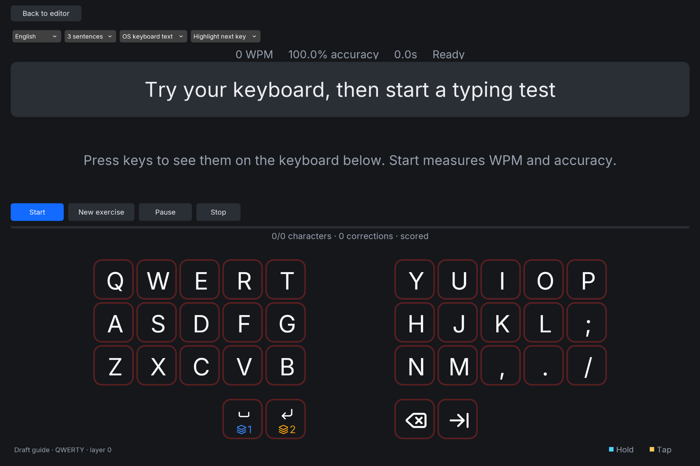
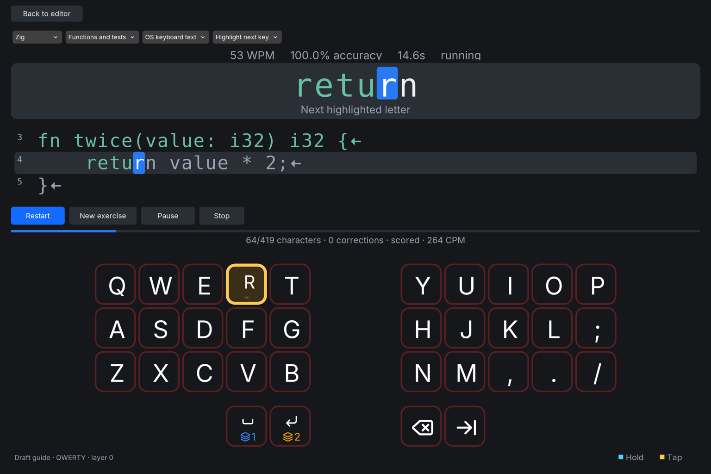
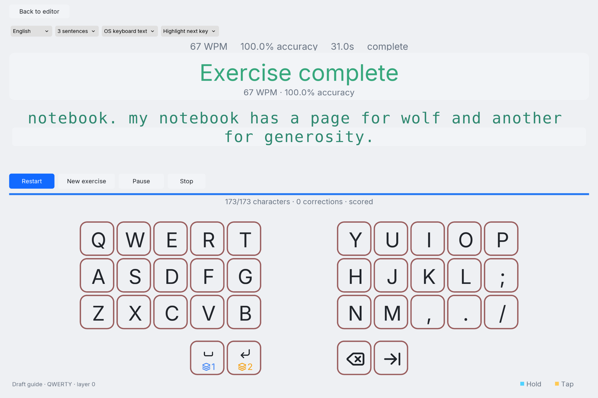

# Typing practice

Choose **Open tutor** in the editor to try your keyboard and run short typing
tests. The tutor keeps nothing between sessions: it saves no results, history or
settings.

## Try your keyboard

Before you start a test, the tutor shows the layout of the connected keyboard
and highlights each key you press, with the active layer and modifiers. After
flashing a new layout in the editor, open the tutor to check it key by key.



The keyboard shows the verified live keyboard when one is connected. Without
one, it shows the editor's project as a draft guide. Native OS text never counts
as physical key telemetry.

## Typing tests

Choose **English** and the number of sentences (1, 3, 5 or 10), or **Zig** and
one of three short code lessons, then press **Start**. Type the text as shown;
a mistake stays red until you correct it with Backspace.


- **WPM** counts five correct characters as one word, over the active time.
  Zig lessons also show characters per minute (CPM).
- **Accuracy** is the share of typed characters that were correct. Corrections
  are counted separately.
- Pasted text is shown as a preview and not scored.
- **Pause**, Escape or leaving the window pauses the test, and **Resume**
  continues it. **Restart** and **New exercise** start new English text; for
  Zig, **New exercise** moves to the next lesson. **Stop** ends the test.



When the text is complete, the tutor shows the final speed and accuracy.



## Keyboard guide

- **Highlight next key** marks the key to tap in amber and any key to hold,
  such as Shift or a layer key, in cyan.
- **Keyboard only** shows the layout and your presses, without targets.
  During a test it hides presses.
- **No keyboard** hides the keyboard, including a companion window, during
  practice. Returning to the editor restores the companion.

Shift guidance prefers a home-row modifier on the opposite hand. Unknown
translation placeholders, named keys and callback text are never presented as
typing routes.

## Input source

**OS keyboard text** scores the text your operating system delivers, so it
works with any keyboard. **Unflashed draft** runs the editor's current draft on
the prepared native processor and scores its output: build the draft first,
then press **Resume** once it is ready. Editing the draft or changing the
operating system's input source pauses the test and asks for a fresh exercise.

## Tests and fixtures

Run the typing test, generator and controller tests without the firmware
package:

```sh
zig build test-practice -Donly=practice
```

The offline GUI fixtures (`zig build test-desktop -Ddesktop`) type through OS
text (`--offline-practice-frames 3`) and through the draft processor
(`--offline-draft-frames`). The native `--native-tutor-frames 16` fixture
renders the screenshots above to `.zig-cache/typing-practice-gallery/`.
