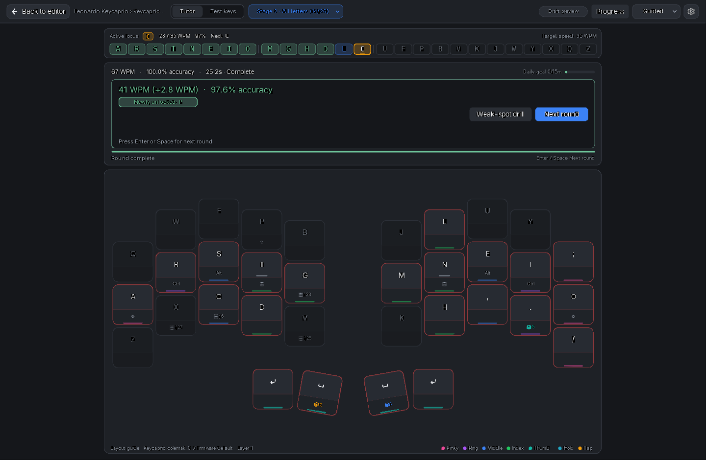

# Typing Tutor & Test Keys

Choose **Open tutor** in the Companion Editor to learn your layout step by step
or to verify switches, layers, holds, and combos on your keyboard.

The top bar provides a **Tutor | Test keys** segmented switch so hardware
checking stays completely separate from adaptive typing practice.

## Adaptive Typing Tutor

Opening **Tutor** starts a ready round immediately—no setup modal required.
Every drill adapts automatically to your active board geometry, keymap layers,
home-row modifiers, and 2-key combos.


### Key-confidence strip & focus-key unlocks

Above the text stage, the **key-confidence strip** displays your unlock order
derived directly from your layout's home row and English letter frequency:

- **Green keys** have reached your target speed (default **35 WPM**) with at
  least **95% first-try accuracy** across enough clean motor samples.
- **Blue keys** are unlocked and climbing toward mastery.
- **Amber key** is your current **focus key**; drills bias roughly half of all
  words toward words containing the focus key.
- **Dimmed keys** are locked until your current focus key reaches 100%
  confidence (at most one new key unlocks per round, with a 2-round minimum
  cooldown so progress stays calm and steady).

### Calm typing stage & Stop-on-error flow

The text card shows a clean three-line monospace window with live **WPM**,
**accuracy**, elapsed time, and your **daily goal** bar:

- **Stop on error (default in Stages 1–5):** Mistyping highlights the cursor in
  red and waits for the correct key so muscle memory locks in the right motion
  without Backspace detours.
- **Keyboard-only loop:** Press **Esc** to pause/resume, **Tab** for a fresh
  round (in Zig code drills, Tab inserts four spaces), and **Enter** or
  **Space** after a round completes to start the next round immediately.
- Leaving the window automatically pauses the active round.



### 6-Stage Learning Path

Click the **Stage** pill in the top bar to open the **Stages** sheet. All six
stages are derived from your active layout and can be selected freely at any
time:

1. **Stage 1 · Home row** — Your layout's home-row keys plus thumb Space.
2. **Stage 2 · All letters** — Adaptive 26-letter progression with key
   confidence and focus-key unlocks.
3. **Stage 3 · Shift & capitals** — Balanced 50/50 left- and right-hand
   capitalization with opposite-hand Shift guidance (and a subtle nudge if
   Live-HID detects a same-hand Shift press).
4. **Stage 4 · Punctuation & numbers** — Grouped drills for reachable
   punctuation and digit keys.
5. **Stage 5 · Layers & combos** — Auto-previewing layer symbols and 2-key
   project combos (switchable between **Mixed**, **Combos**, and per-layer).
6. **Stage 6 · Free text & code** — English prose, Zig code lessons, pasteable
   custom text, and 1-click **Weak-spot drills** targeting your slowest keys
   and transitions.


### Visual keyboard guidance (Tap, Hold, One-shot & Combos)

The physical keyboard canvas matches the Companion Editor's Tap/Hold keycap
anatomy, exact split PCB geometry, and rotated thumb keys:

- **Guided** shows finger-zone accents, tactile index home-row bumps, a
  home-anchor ring with directional motion chevron for off-home keys, **amber**
  `TAP` highlights, **cyan** `HOLD` / `1-SHOT` highlights with a dashed bridge
  arc, automatic target-layer previews, and **purple** 2-key `COMBO` arcs.
- **Hesitation** keeps the keyboard quiet while you flow and gently reveals
  guidance if you pause for more than one second or mistype.
- **Free** hides the keyboard (including the companion overlay window while
  practicing; returning to the editor restores it cleanly).


## Progress & Local Persistence

Click **Progress** in the top bar to inspect your recent average WPM, accuracy,
unlocked-key count, a native vector **WPM trend & unlock chart** (with target
WPM line, raw dots, smoothed EMA curve, and `+X` unlock markers), and your
**Weakest keys & transitions** with a 1-click **Weak-spot drill** launcher.


All progress is stored **locally on your machine**—no account, no cloud sync,
and no external database:

- `<app_data>/tutor/profiles/<profile_hash>/state.zon` — atomic snapshot of
  your per-key EMA speed/accuracy, unlocked keys, daily streak, and settings.
- `<app_data>/tutor/profiles/<profile_hash>/runs.jsonl` — append-only round
  history loaded on demand when you open the Progress sheet.

Profiles are scoped to your board, base layout, and host keyboard layout.
Moving an individual key in the editor only resets statistics for the moved
keys rather than wiping your whole profile. Use the top-right **Settings**
popover to adjust target speed (WPM), daily goal, guidance level, input source,
or to reset progress for the active profile.

## Test Keys Mode

Switch the top bar to **Test keys** to inspect physical switch presses, active
layers, held modifiers, simultaneous key presses, and triggered 2-key combos
without scoring or recording tutor history.


## Input Sources

- **OS keyboard text (Live keyboard):** Scores text delivered by your operating
  system and overlays real physical telemetry when your verified Zigmkay
  keyboard is connected (including a brief red flash on physical mis-keys).
- **Unflashed draft:** Runs your editor's current draft through the prepared
  native firmware processor so you can practice and test layout changes before
  flashing.

## Tests & Fixtures

Run the standalone practice engine, layout profile, learning model, generator,
storage, and controller tests without building firmware:

```sh
zig build test-practice -Donly=practice
```

Run the full desktop test suite and headless SDL GUI fixtures (including
`--offline-practice-frames 3`, `--offline-draft-frames`, and the 8-scene
Dark/Light `--offline-tutor-frames 32` gallery):

```sh
zig build test-desktop -Ddesktop
```

To render native GPU screenshots of the same 8-scene Dark/Light gallery into
`companion/.zig-cache/typing-practice-gallery/`:

```sh
zig build -Ddesktop && ./zig-out/bin/zigmkay-companion --native-tutor-frames 32
```
