# Test Layout & Adaptive Typing Tutor

Choose **Open tutor** under **Try it out** in the Companion Editor to test your
layout freely or switch to the adaptive 6-stage Typing Tutor.

The top bar provides a **Test layout | Tutor** segmented switch. Opening from
**Try it out** always lands in **Test layout** first so you can immediately
verify switches, layers, holds, combos, and free-type in its text field before
switching to **Tutor**.

## Adaptive Typing Tutor

Opening **Tutor** starts a ready lesson immediately—no setup modal required.
Lessons follow each other without a stop: when you type the last letter of a
lesson, it is counted and the next one is already there. Lessons in Stages 1
and 2 are about 100 letters of real English words; every drill adapts to your
active board geometry, keymap layers, home-row modifiers, and 2-key combos.

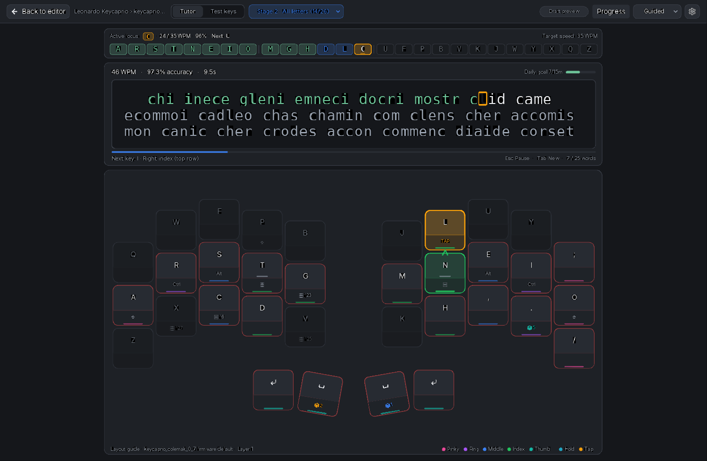

### Key-confidence strip & focus-key unlocks

Above the text stage, the **key-confidence strip** displays your unlock order.
By default the Tutor starts with six letters: as many from your layout's home
row as still form at least 40 real English words, with both hands taking part
and typing about the same amount; on Colemak that is **E S R T N O**, on QWERTY
**S A L D I K**. Every later letter is the one that adds the most frequent
words, preferring the hand with fewer letters, and every lesson picks its
words so that both hands type about as much. **Home row first** in the Stages
sheet unlocks the whole home row first instead; switching keeps every letter
you have unlocked.

- **Green keys** have reached your target speed (default **20 WPM**; Settings
  offers 15–45) with at least **28 of their last 30 presses right on the first
  try** across enough clean motor samples. Older mistakes stop counting once
  they are 30 presses back. A key that was green once **stays green and
  unlocked**, whatever its later presses look like.
- **Blue keys** are unlocked and climbing toward mastery.
- **Amber key** is your current **focus key**: the least confident key that is
  not green yet. Every word of a lesson contains it while at least 15 real
  words fit the unlocked letters.
- **Dimmed keys** are locked until all unlocked keys are green (at most one new
  key unlocks per lesson, with a 2-lesson minimum cooldown so progress stays
  calm and steady). A letter you master in a later stage's text is unlocked
  right away.

Two hairline bars under each practised chip show what the key still needs:
speed toward the target on the left, first-try hits in its last 30 presses on
the right, with a tick at the 28 it needs. Hover a chip for the numbers; the
header names them for the focus key.

When a letter has gone **four lessons without progress**, a calm note appears
under the strip and stays while you type. If misses hold it back, it suggests
slowing down and offers a **slow lesson** around that letter whose speed does
not count. If only speed holds it back, it offers to lower the target by one
preset step. Each button has a shortcut so your hands stay on the keyboard:
**Ctrl+Down** lowers the target, **Ctrl+P** practises the letter and
**Ctrl+Backspace** dismisses the note until the letter moves again (Cmd works
as well on macOS).

### Calm typing stage & forgiving input

The text card shows a clean three-line monospace window with live **WPM**,
**accuracy**, elapsed time, and your **daily goal** bar:

- **Forgiving (default):** a wrong key leaves the cursor where it is and marks
  the position quietly: a thin red line under the cursor and the wrong key
  beside it. Type the right key, or simply keep typing: once your next three
  keys match the text after a skipped or wrong letter, the Tutor moves past it.
  However many keys it took, a position counts as one mistake, and accuracy
  counts positions. **Backspace** only takes back wrong keys, never accepted
  text, and an extra Space at the start or between words is ignored.
- **Stop on error** (Settings → Typos) waits for the right key and counts
  every wrong key.
- **Keyboard-only loop:** Press **Esc** to pause/resume and **Tab** for fresh
  text (in Zig code drills, Tab inserts four spaces). There is nothing to
  confirm between lessons.
- Leaving the window pauses the lesson; ten seconds without a key pause the
  clock silently and the next key carries on.

Until the first key of a lesson, the metrics row shows the last lesson (speed
with its change, accuracy, time) and the keyboard shows how each key went in
it: green clean, amber slower than the target, red missed. New letters, keys
that turned green, the daily goal and the move from Stage 1 to Stage 2 appear
as short notices that fade after three seconds. Every fifth lesson of Stages 1
and 2 is built around your slowest letter pair, marked **Weak spot** in the
metrics row.


### Refreshing letters that slipped

A green letter stays green and unlocked, but it can still get rusty. It
counts as **slipped** once it is clearly below the bar again: slower than
80 % of the target speed, or fewer than **26 of its last 30 presses** right.
It needs at least 30 presses after it was mastered first, so one bad lesson
right after mastering does not count. A slipped letter gets an **amber dot**
in the top-right corner of its chip; its hover card shows its speed now
against its best and the target, its recent hits, and what happens next.
Unlocking never waits for slipped letters.

At most every third lesson of Stages 1 and 2 (never a weak-spot, slow or
"Practise" lesson) becomes a **refresh lesson** around the weakest slipped
letter. The strip header then reads, for example, **Refresh: K · slower than
its best lately: 14 vs 26 WPM · Hits 25 of last 30 · then back to P**, the
refreshed chip gets an amber border, the metrics row says **Refresh lesson ·
every word has K**, and every word contains it. The next lesson goes back to
the new letter.

Independently of that, every lesson of Stages 1 and 2 prefers words that
also practise weak letters besides the focus letter: unlocked letters that
are not green, have low confidence or slipped. Each word's frequency weight
is multiplied by `1 + 2 × (the summed weakness of its other letters)`, at
most 4, where a letter's weakness is what it lacks of full confidence (at
least 0.5 for a slipped letter). The focus letter stays in every word, the
hands stay balanced, and the same seed gives the same lesson. In the
simulated learner, words with a slipped letter go from about a third of a
lesson to about half.

**Settings → Refresh slipped letters** turns both off (no refresh lessons,
no dots, words by frequency alone) and is saved per person.

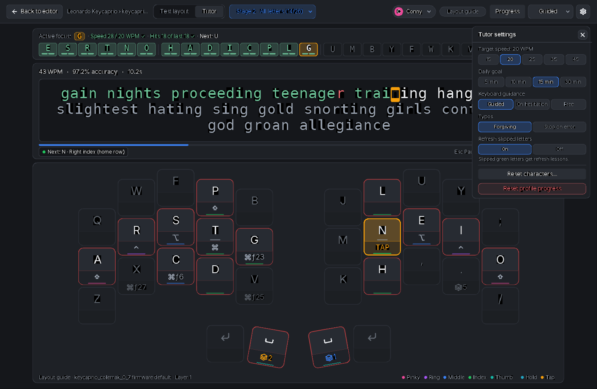

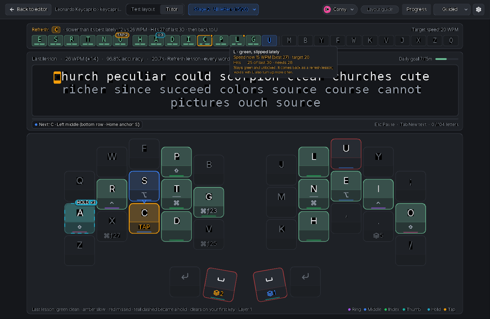

### 6-Stage Learning Path

Click the **Stage** pill in the top bar to open the **Stages** sheet. All six
stages are derived from your active layout and can be selected freely at any
time:

1. **Stage 1 · First letters** — The first letters of the letter order (for
   example E S R T N O on Colemak, or your home row with **Home row first**)
   as real words, around the weakest of them; once they are green, the Tutor
   moves on to Stage 2 by itself.
2. **Stage 2 · All letters** — Adaptive 26-letter progression with key
   confidence and focus-key unlocks.
3. **Stage 3 · Shift & capitals** — Balanced 50/50 left- and right-hand
   capitalization with opposite-hand Shift guidance (and a subtle nudge if
   Live-HID detects a same-hand Shift press).
4. **Stage 4 · Punctuation & numbers** — Grouped drills for reachable
   punctuation and digit keys.
5. **Stage 5 · Layers & combos** — Auto-previewing layer symbols and 2-key
   project combos (switchable between **Mixed**, **Combos**, and per-layer).
6. **Stage 6 · Free text & code** — English prose, Zig code lessons, pasteable
   custom text, and 1-click **Weak-spot drills** targeting your slowest keys
   and transitions.

Below the stages, **Letter order** switches between **Word-forming first** and
**Home row first**; the sheet says when your layout's home row holds most of
the first letters anyway, as on Colemak.

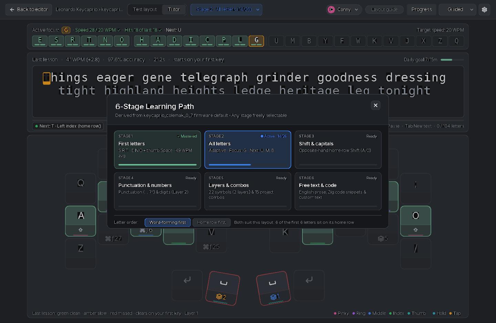

### Visual keyboard guidance (Tap, Hold, One-shot & Combos)

The physical keyboard canvas matches the Companion Editor's Tap/Hold keycap
anatomy, exact split PCB geometry, and rotated thumb keys:

- **Guided** shows finger-zone accents, tactile index home-row bumps, a
  home-anchor ring with directional motion chevron for off-home keys, **amber**
  `TAP` highlights, **cyan** `HOLD` / `1-SHOT` highlights with a dashed bridge
  arc, automatic target-layer previews, and **purple** 2-key `COMBO` arcs.
- **Hesitation** keeps the keyboard quiet while you flow and gently reveals
  guidance if you pause for more than one second or mistype.
- **Free** hides the keyboard (including the companion overlay window while
  practicing; returning to the editor restores it cleanly).


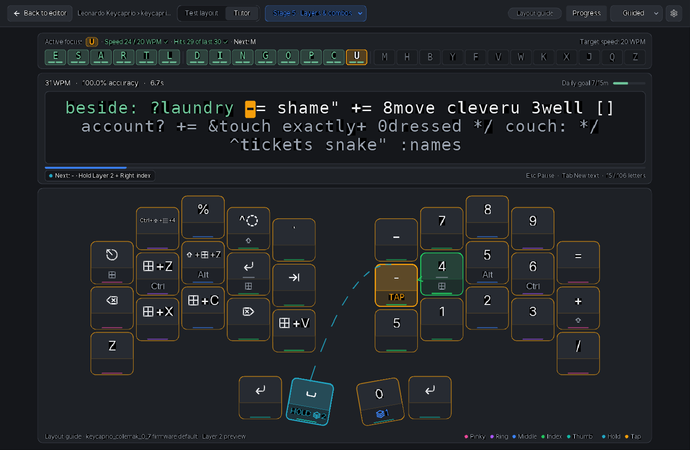

## Progress & Local Persistence

Click **Progress** in the top bar to inspect your recent average WPM, accuracy,
unlocked-key count, a native vector **WPM trend & unlock chart** (with target
WPM line, raw dots, smoothed EMA curve, and `+X` unlock markers), your
**Weakest keys & transitions** with a 1-click **Weak-spot drill** launcher, and
**Recent lessons**: speed and its change, accuracy, and what each lesson
brought (a new letter, keys that turned green, a weak-spot pair, the weakest
keys after it).

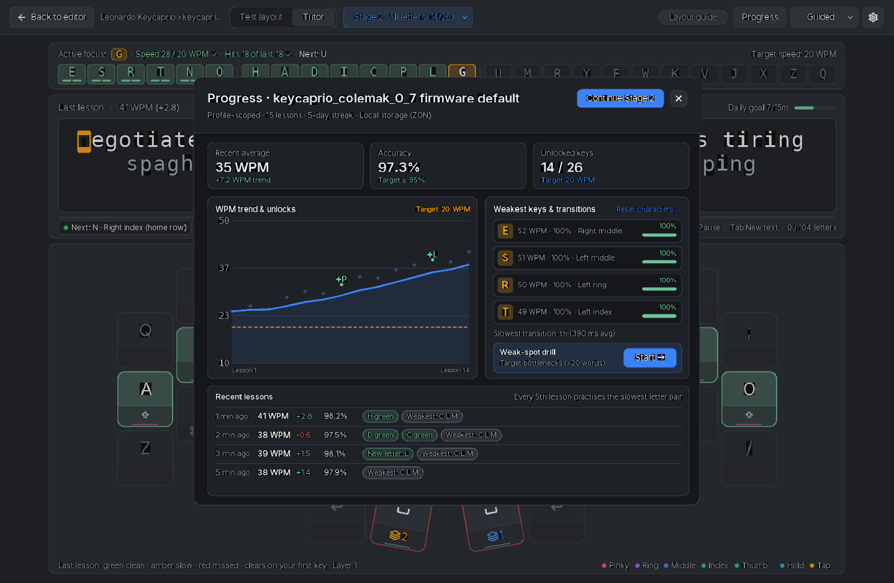

All progress is stored **locally on your machine**—no account, no cloud sync,
and no external database. Every person has a directory
`<app_data>/tutor/people/<id>/`, and `<app_data>/tutor/people.zon` names them:
their id, name, colour, when they were created and last used, and who
practises now. Per person and layout type:

- `<app_data>/tutor/people/<id>/profiles/<profile_hash>/state.zon` — atomic
  snapshot of
  your per-key EMA speed (and the best it reached), the outcome of each key's last 30 presses, unlocked keys, daily streak, settings, the
  key positions your statistics were made at, and the single-character labels
  of up to eight keyboards you practised on (schema 3; a schema 2 file loads
  and keeps its unlocked letters in the new order, an older one is kept as
  `state.zon.corrupt` and the profile starts over).
- `<app_data>/tutor/people/<id>/profiles/<profile_hash>/runs.jsonl` —
  append-only lesson history loaded on demand when you open the Progress
  sheet.

Builds before personal profiles kept the layout directories in
`<app_data>/tutor/profiles/`. On the first start the Tutor writes
`people.zon` with one person, **Me** (rename it in the menu), and then moves
each layout directory into `people/<id>/profiles/` with one atomic rename. A
layout directory is always either at its old or at its new place, so an
interrupted move loses nothing: the next start finishes it, and a later start
changes nothing. A layout directory that the person already has stays at the
old place untouched. If `people.zon` cannot be read, it is kept as
`people.zon.corrupt` and rebuilt from the person directories (names other than
**Me** become "Profile 2" and so on); progress stays where it is.


With a connected Zigmkay keyboard running current firmware (companion
protocol version 2), the Tutor also records how each tap/hold key resolved
during a lesson: home-row modifiers, a layer-tap Space and the like. The
keyboard reports every decision (tap, hold or retro tap, why, and how long it
took within the tapping term), and the Tutor compares it with the text at the
cursor. Per character the key types on tap, `state.zon` keeps the last 30
decisions as accidental holds (the letter was wanted, Shift or a layer
fired), accidental taps (the hold was wanted, the letter came), near holds
(a correct tap late in the tapping term) and wanted ones, the reasons, the
typical decision time and how long a rolled-over key overlapped; each
`runs.jsonl` line counts the lesson's accidental holds and taps. This never
changes speed or accuracy: a wrong character still counts as a miss. Older
keyboards, other keyboards and offline practice simply record nothing, and
saves and history lines from before this load unchanged.

A profile is a layout type, not a keyboard: it is scoped to the home-row
letters and the host keyboard layout. The same layout on two keyboards shares
its progress, while QWERTY and Colemak stay apart. Key positions are compared
by hand, finger and row.

### Personal profiles

Several people can practise on one computer. The **person chip** in the
Tutor top bar (initial and colour, then the name) opens a menu with everyone
and their progress on the layout type you practise now, such as **16/26
letters · 5-day streak** or **7/26 letters · practised yesterday**. Pick a
person to switch, or choose **New profile…**, **Rename “Conny”…** or
**Delete “Conny”…**. Deleting asks once more, **Delete “Conny” and all of its
progress?**, and the last remaining profile cannot be deleted. A new profile
needs a name (at most 24 characters, not used by anyone else; spaces around it
are dropped) and one of five colours; **Create and switch** starts it fresh,
Enter confirms and Esc cancels. While the menu or the dialog is open, nothing
you type reaches the lesson. Test layout shows no chip: it is shared and
never scored.

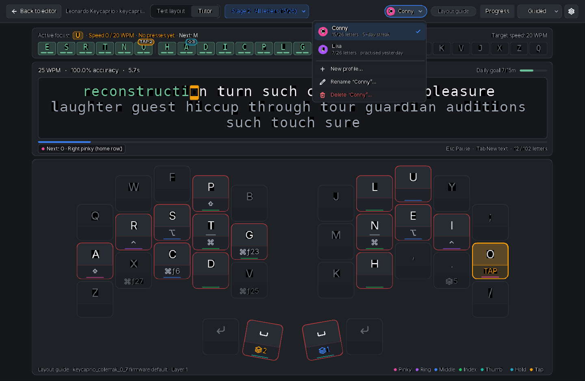

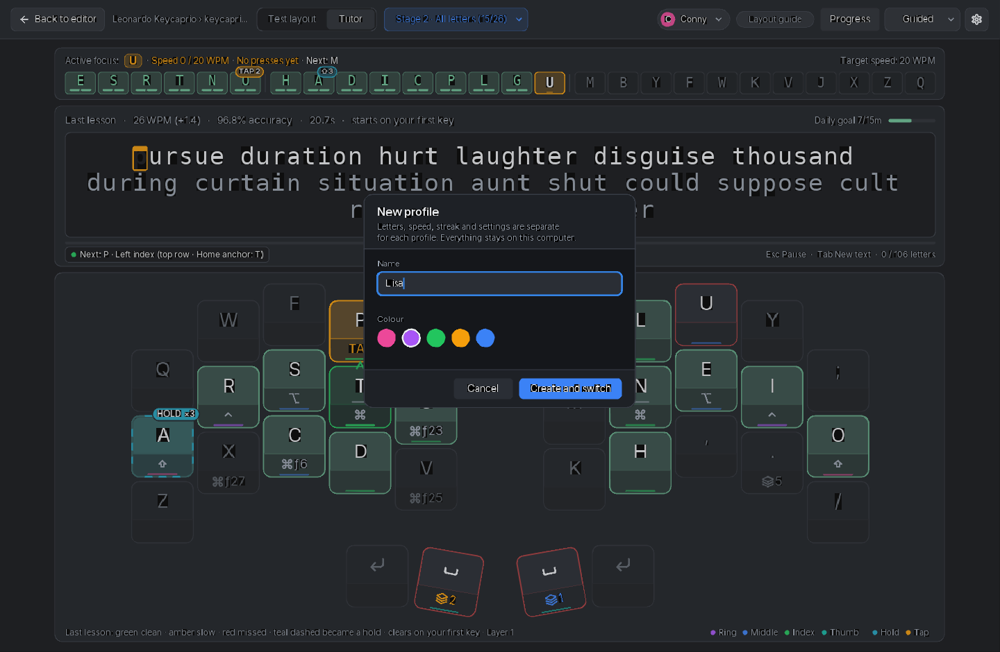

Everything of the Tutor is per person: letters and statistics, tap/hold
statistics, streak and daily goal, settings, lesson history and the answers to
the layout-change question. A switch happens between lessons: a lesson in
progress is dropped and counts for nobody, while everything already finished
is saved for the person you leave first. The next start opens with the person
who practised last. The keyboard and its live view stay shared.

### Tap/hold feedback

Home-row modifiers and a layer-tap Space make a typical mistake: a quick roll
into the next key turns the letter into Shift or a layer, or a capital comes
out lowercase because the Shift key was released too early. With a connected
Zigmkay keyboard running current firmware, the Tutor and Test layout show
these from the keyboard's own decisions. Other keyboards, older firmware and
offline practice show nothing of this, and the scoring does not change: an
accidental hold still counts as a normal miss of the letter.

- **Test layout** adds a second row to the telemetry bar with the last four
  decisions, newest on the right: the key, `tap 96 ms`, `tap 171 ms · close`
  once a tap took at least 75 % of the tapping term, or a teal `HOLD ⇧ 143 ms`
  with the glyph of the hold. A sentence on the right explains the newest one,
  for example "A became Shift after 143 ms (term 200 ms): N went up while A
  was still down". The key that held gets a teal outline with `HOLD ⇧` on the
  keyboard, the key whose release made it hold a blue one with `went up`;
  both fade after two seconds. Test layout stays unscored: these decisions are
  only shown. A keyboard with older firmware (protocol version 1) shows
  "needs current firmware on the keyboard"; without a connected Zigmkay
  keyboard the row asks you to connect one.
- **Confidence strip:** a key with at least two accidental holds in its last
  30 decisions carries a small teal marker such as `⇧3`; one that tapped at
  least twice when its hold was wanted carries an amber `TAP 2`. Its hover card
  adds a section such as **Home-row Shift (hold A)**: how often it became
  Shift, what usually caused it (still down when the next key went up, or held
  past the tapping term), close calls, and a **Details in Progress** link.
- **After a lesson** in which a key held (or tapped) by mistake, a notice
  such as "A became Shift 3× · let go before the next key" (a roll) or "· tap
  it quicker" (the term elapsed), or "Shift on O came as a tap 2× · hold it
  until the letter", shows for three seconds with the other notices. A key gets
  it at most once every five lessons. Clicking it opens Progress at the
  section below. The last lesson's keyboard outlines such a key teal dashed
  with `HOLD ×3` (amber dashed with `TAP ×2` for taps).
- **Progress → Tap/hold keys** lists the tap/hold keys by accidental holds:
  the key and what it holds, how often it became a hold by mistake in its last
  30 decisions, close calls, the usual cause, and a mini keyboard marking the
  affected keys. Once a key has 50 decisions and its holds come from holding
  past the tapping term, it suggests a longer term, for example `Term 200 →
  230 ms`; clicking it opens the key in the editor with the tapping term field
  focused, and nothing changes until you flash. When the holds come from
  rolling into the other hand, a longer term does not help, so it says
  `practice: let go sooner` instead. Recent lessons are tagged `A → Shift ×2`
  when a key held by mistake.

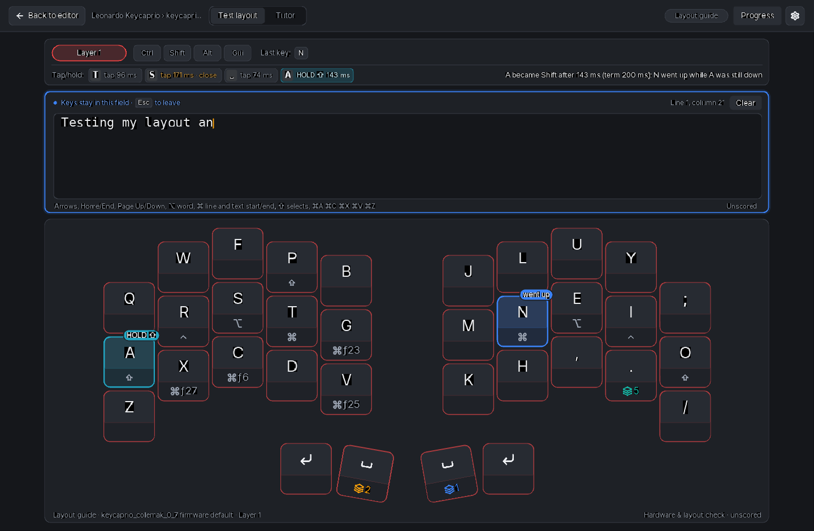

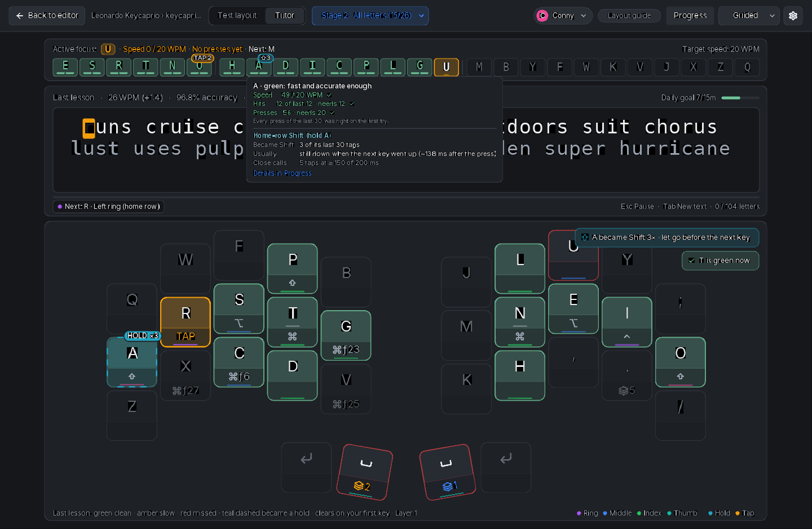

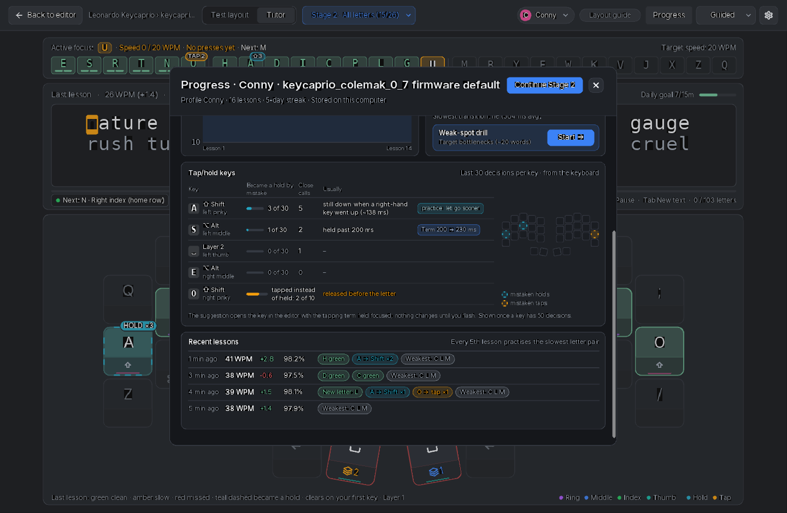

### Moved keys

Statistics are never reset on their own. When another keyboard or an edited
layout puts a character you have practised somewhere else, for example a
letter that becomes a combo or a symbol that moves to another layer, the
Tutor asks once, before a lesson starts and never while you type:

- **Keep statistics** (or **Keep all**) keeps them. The new position joins the
  ones the statistics count for, so switching back and forth between these
  keyboards asks nothing again, also after a restart.
- **Reset** starts that character over at its new position.
- **Show change** or **Review changes…** opens **Layout changes**: one row per
  character with **Keep** or **Reset**, and the key on the keyboard you
  practised it on (dashed) next to the key on the current one, with the held
  layer key and both keys of a combo marked.

A letter and its capital count as one entry. Each character remembers up to
four positions; a fifth replaces the oldest, which can bring the question back
once. A question you leave unanswered is asked again after the next lesson.

### Reset characters

**Settings → Reset characters…** (also linked from **Weakest keys &
transitions** in Progress) starts chosen letters and symbols over: their
speed, accuracy and every transition into or out of them. Letters stay
unlocked, but a reset letter has to be mastered again before the next one
unlocks, and it usually becomes the focus key. Streak, daily goal and round history
are unchanged. The sheet marks the chosen keys on the current keyboard, lists
practised characters this layout cannot type under **Not on this layout**, and
asks for confirmation.

Use the top-right **Settings** popover to adjust target speed (WPM), daily
goal, guidance level, how typos are handled, or to reset all progress for the
active profile.

## Test Layout Mode

Opening **Try it out** lands directly in **Test layout**. It pairs the exact
shared Editor keyboard view with a live telemetry bar (active layer, held
modifiers, simultaneous presses, triggered 2-key combos and the last key) and
a multi-line text field where you can type anything you want—completely
unscored and unpersisted. The field holds up to 8 KB of text; once it is full
it takes no more instead of dropping the start.

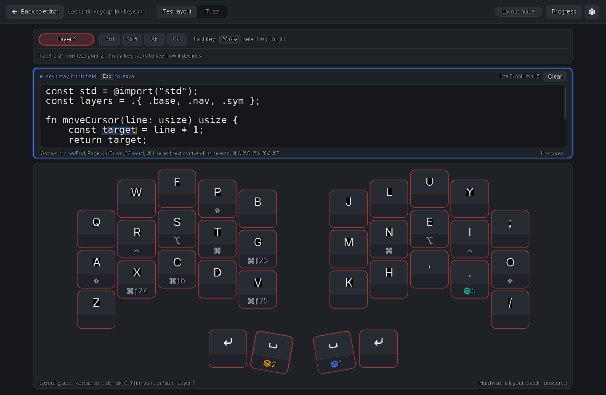

### Keys stay in the field

Test layout opens with the field **holding the keys**: an accent border and
"Keys stay in this field · Esc to leave" above the text. Every key you press
then stays in the field, so you can try your layout's navigation layer the way
you would use it in an editor:

| Keys (macOS) | Keys (Windows/Linux) | What they do |
| --- | --- | --- |
| ← → ↑ ↓ | ← → ↑ ↓ | Move by character and by row (long lines wrap) |
| Home / End, ⌘← / ⌘→ | Home / End | Line start / end |
| Page Up / Page Down | Page Up / Page Down | Move by the rows in view |
| ⌥← / ⌥→ | Ctrl+← / Ctrl+→ | Word left / right |
| ⌘↑ / ⌘↓, ⌘Home / ⌘End | Ctrl+Home / Ctrl+End | Text start / end |
| ⇧ with any move | Shift with any move | Extend the selection |
| ⌫ / ⌦, ⌥⌫ / ⌥⌦, ⌘⌫ / ⌘⌦ | Backspace / Delete, Ctrl+Backspace / Ctrl+Delete, Ctrl+Shift+Backspace / Ctrl+Shift+Delete | Delete a character, a word, to the line start / end |
| Enter, Tab | Enter, Tab | New line, four spaces |
| ⌘A ⌘C ⌘X ⌘V | Ctrl+A Ctrl+C Ctrl+X Ctrl+V | Select all, copy, cut, paste |
| ⌘Z, ⇧⌘Z | Ctrl+Z, Ctrl+Y or Ctrl+Shift+Z | Undo, redo |

Clicking places the cursor (⇧-click and dragging select), the wheel scrolls,
and the header shows the cursor's line and column. **Clear** empties the
field; undo brings the text back. The telemetry bar names every key with its
modifiers and what it did, such as "Last key: ⌥⇧← select word left". Other
shortcuts the application would otherwise react to, such as ⌘D or Tab between
the controls, do nothing while the field holds the keys and only show as the
last key.

Shortcuts the operating system handles before the application sees them
cannot be caught: on macOS ⌘Tab, ⌘Space, Mission Control and the application
menu's ⌘Q (Quit), ⌘H and ⌥⌘H (Hide), ⌘M (Minimize), ⌘W (Close window) and
⌃⌘F (Full Screen); on Windows Alt+Tab, Alt+F4 and the Windows key; on Linux
whatever the desktop reserves. Test those keys elsewhere.

### Leaving the field

**Esc** lets go of the keys: the border turns plain, the cursor hides and the
header reads "Free typing · click here or press Enter to type again". Tab and
the arrow keys then move between the controls as usual. Click into the text,
or press **Enter** while no button has the focus, to hold the keys again; the
text, cursor and selection are kept. While Progress, Settings or another sheet
is open, Esc closes it first and the field keeps holding the keys.

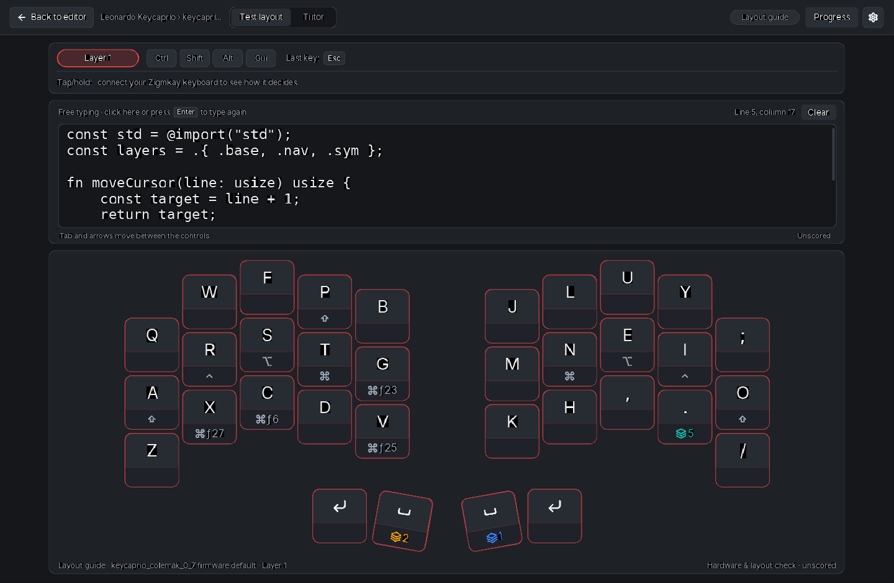

## Input Source

Practice and Test layout always score the text your operating system delivers
from the connected keyboard, and overlay real physical telemetry when your
verified Zigmkay keyboard is connected (including a brief red flash on physical
mis-keys with **Stop on error**). A layout that is not flashed yet cannot be practised: the Tutor shows
a notice above the keyboard when no keyboard is verified for the layout or when
the editor holds changes the keyboard does not run yet. Flash the layout first.

## Word list

Lessons use `src/desktop/tutor_words_en.txt`: about 29,000 English words, most
frequent first, with the letter order in its header. It is generated, never
edited by hand. To regenerate it, download the three files the generator
names into one directory and run, from `companion/`:

```sh
zig build gen-tutor-words -- /absolute/path/to/downloads
```

The generator checks each download against its pinned SHA-256. Words to leave
out go into `tools/tutor_words_deny.txt` (a `*` line removes every word that
contains it). The list is licensed CC BY-SA 4.0; see
[NOTICE](../NOTICE) and the [license note](../README.md#license).

## Tests & Fixtures

Run the standalone practice engine, layout profile, learning model, generator,
storage, and controller tests without building firmware:

```sh
zig build test-practice -Donly=practice
```

Run the full desktop test suite and headless SDL GUI fixtures (including
`--offline-practice-frames 3` and the 31-scene
Dark/Light `--offline-tutor-frames 124` gallery):

```sh
zig build test-desktop -Ddesktop
```

Play simulated learners (a fluent and a beginner typist) through all six stages
on every bundled default keymap. It checks that every lesson can be finished,
that progress never moves backwards and that saved progress reloads unchanged.
`zig build test` compiles it but does not run it:

```sh
zig build test-tutor-learner
```

The screenshots in this document and the Tutor screenshot of the root README
are the dark scenes of that gallery. Regenerate them whenever the Tutor's look
changes, so they never show an older version:

```sh
zig build doc-screenshots -Ddesktop
```

To render native GPU screenshots of the same 31-scene Dark/Light gallery into
`companion/.zig-cache/typing-practice-gallery/`:

```sh
zig build -Ddesktop && ./zig-out/bin/zigmkay-companion --native-tutor-frames 124
```

## Manual hardware checklist

Automated tests never touch a keyboard. Before a release, walk through this
list once per layout type with a real board (for example a Molekula and an
LK07 running the same layout):

1. **Try it out** with the flashed layout connected: Test layout opens, the
   status pill reads live and no notice is shown above the keyboard.
2. Change a key in the editor without flashing: the notice about unflashed
   editor changes appears; after flashing it disappears.
3. Unplug the keyboard: the Tutor waits for a keyboard that runs the layout
   instead of scoring text against the wrong layout.
4. Test layout: every key lights up when pressed; holding a layer key switches
   the shown layer; held modifiers appear in the telemetry bar.
5. Test layout: a two-key combo shows "Combo keys held" and the character lands
   in the text field.
6. Test layout with home-row modifiers: roll from a home-row modifier into a
   key of the other hand (for example A then N, releasing N first). The
   telemetry bar's Tap/hold row shows a teal `HOLD ⇧` chip and explains it, and
   both keys are outlined on the keyboard for two seconds. Then do the same in
   a Tutor lesson: after the lesson the "became Shift" notice appears, and
   **Progress → Tap/hold keys** lists the key. With an older firmware the row
   reads "needs current firmware on the keyboard".
7. Test layout text field: type or paste a few lines, then move through them
   with only the layout's navigation layer: arrows, Home/End, Page Up/Down,
   word jumps (⌥ or Ctrl) and line and text jumps (⌘ or Ctrl), each once with
   Shift to select; then cut, paste and undo. The cursor and selection follow,
   the field scrolls with the cursor, and the telemetry bar names each key
   (for example "⌥⇧← select word left"). A shortcut such as ⌘D only shows as
   the last key. Esc lets go (plain border, Tab moves between the controls);
   Enter or a click takes the keys back with the text and cursor unchanged.
8. Tutor Stage 2: finish a lesson; the next one appears at once with the last
   lesson in the metrics row and on the keyboard. Skip a letter and keep
   typing: after three more letters the Tutor moves on and counts one mistake.
9. Tutor Stage 3 and 5: the hint shows the Shift, layer or combo keys that the
   layout really uses for the highlighted character.
10. Quit and restart the application: unlocked letters, streak and round count
    are unchanged.
11. Connect the second board with the same layout: the same progress is shown
    and no key statistics are reset. If a practised character sits elsewhere
    there, the question appears once, only before a lesson starts; choose
    **Keep all**, then switch boards twice more: nothing is asked again.
12. **Settings → Reset profile progress** resets only the active profile of
    the current person; a different layout type and other people keep their
    progress.
13. **Settings → Reset characters…**: pick two letters and confirm. Only
    those start over, one becomes the focus key, the unlocked count stays, and
    all of it is the same after a restart.
14. First start after updating from a build without personal profiles: the
    chip reads **Me** and every layout type shows its progress as before;
    `tutor/profiles/` is gone and `tutor/people/1/profiles/` holds it.
15. Person chip → **New profile…**: type a name (Esc cancels, Enter
    confirms), pick a colour, **Create and switch**. A lesson in progress is
    dropped; the new person starts at the first letters with default settings
    and no streak. Finish a lesson, switch back: the first person's letters,
    streak, settings and history are unchanged, and the menu shows both
    people's progress on this layout type.
16. Quit and restart: the person who practised last is current. Rename them,
    then delete the other one (two-step confirmation); the last profile offers
    no delete.
17. Let a green letter slow down (type it slowly for a few lessons): its chip
    gets an amber dot, it stays green, and within three lessons a refresh
    lesson names it in the header. **Settings → Refresh slipped letters → Off**
    removes the dot and the refresh lessons.
